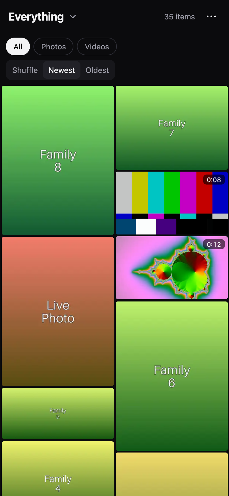
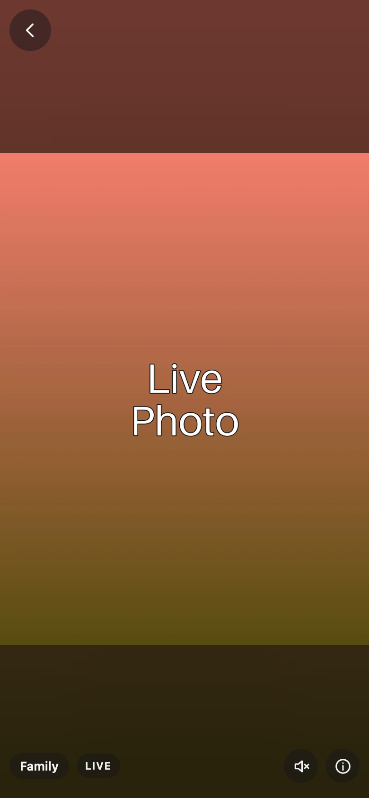
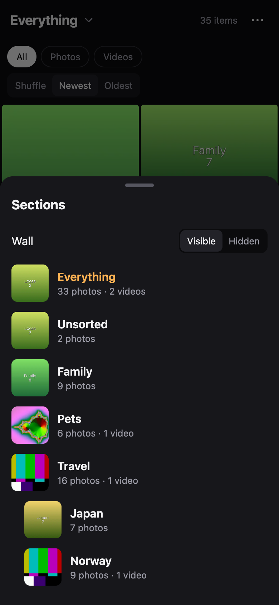
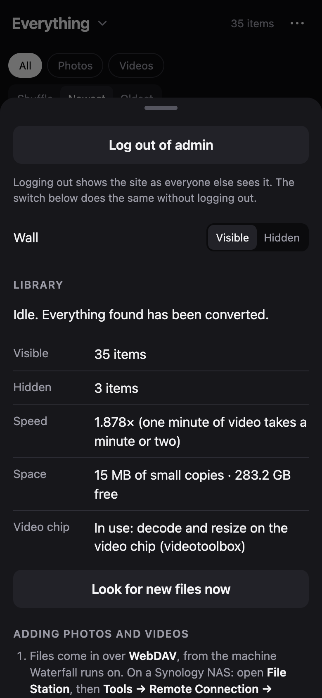

# Waterfall of Photos

## Read this before anything else

**This is a personal project, and the code is AI slop.**

Every line here was written by an AI. I am not a programmer, and I am too ignorant of
programming to find the errors in AI slop code. Nobody who could find them has looked.

| | |
|---|---|
| **Should you use it?** | **No. I do not recommend that anyone use this code.** |
| **If you use it anyway** | It is entirely at your own risk. It handles your photos and removes files on purpose (see "Copy, never move" below). Nothing here is promised to work, to be safe, or to keep anything. |
| **Updates** | Unlikely. Assume this is the last version there will ever be. The software it is built on will go out of date and nobody will repair it. |
| **Support** | None. Zero. Issues and pull requests will most likely never be read. |
| **Has it run on a real NAS?** | **Yes, on the one machine it is built for.** It starts, uses the video chip, shows its wall, takes uploads from its own page, takes copies from the NAS's own file manager (since 0.6.1; every version before refused them) and converts what it is given. That is one machine, for a few days. Nothing below has been seen anywhere else. |

It is public for one reason: so that my own NAS can download it without my carrying a
file to it. That is all.

## What it is

Waterfall is a private scrolling wall for your own photos and videos. It was made for
one household: the pictures live on a NAS at home, and are looked at from a phone a
long way off, over a slow link (about 275 ms away, 1 to 2.6 MB per second).

**It is built for one machine, and every setting in it is that machine's:**

| | |
|---|---|
| Machine | Synology DS920+ |
| Processor | Intel Celeron J4125, 4 cores, 2 GHz, with an Intel video chip |
| Memory | 8 GB |
| System | DSM 7.4.1, with Container Manager |

No other machine has been considered.

| | |
|---|---|
| Opening it | The address shows the **Visible** wall at once. No sign-in, no username. |
| Admin | The **···** menu asks for the admin password. That opens the admin menu: the library status, adding pictures, and the switch to the **Hidden** wall. Signing in does not change the wall; the Hidden one is shown only when that switch is used. Left untouched for half an hour, the page signs the admin out by itself and goes back to the Visible wall. |
| The wall | Every photo and video as a grid that never ends. Shuffle, Newest or Oldest; All, Photos or Videos. Video tiles play a few silent seconds. |
| Sections | Each folder is a section; a folder inside a folder is a sub-section. |
| Tags | The admin can tag an item so that it also appears in another section, without a second copy of the file. |
| The viewer | One item per screen, one swipe per item. Pinch to zoom a photo. Videos choose their own quality from five sizes, 360p to 1440p, to suit the link. |
| Details | When it was taken, the nearest town and country, the camera, and the copies that exist. |
| Removing | Not from the page: it shows and never deletes, so that it can be put in a child's hands. The admin removes things where they were copied in, through the import door. |
| Hidden | Decided by the folder and by nothing else. There are two roots, `Visible` and `Hidden`. What is copied into `Hidden` needs the admin password from the moment it arrives. |
| Adding pictures | Two ways, both needing the admin password. From the admin page: pick a wall and a folder, choose photos and videos on a phone or a computer, and they are uploaded, several hundred at a go if you like. It shows how far it has got, how fast and how long is left; it waits out a dropped connection and carries on. Or from the NAS itself: its file manager copies folders in through the import door. |
| Live Photos | A still and its short clip, copied in together under the same name, become one item: the photo, with a LIVE button. Hold a finger on the photo, or tap LIVE, and the clip plays over it. |

Full-size files are never sent to the phone. Each one is converted once, in advance,
into small copies: three sizes of WebP for a photo; five sizes of H.264 and a short
silent preview for a video.

| The wall | One item | Sections | Admin |
|---|---|---|---|
|  |  |  |  |

The pictures in these screenshots are coloured rectangles made by the test suite. No
real photo is in this repository, and none ever should be.

## Copy, never move

**Waterfall keeps small copies only.** Once a file is converted and its copies are
checked, Waterfall **removes the full-size file** it was given and leaves a small text
file in its place.

If you **move** your photos into it, the copy it removes was the only one, and what
is left is a smaller, lower-quality version. **Only ever copy files in, and keep your
originals somewhere else.** Setting `WATERFALL_KEEP_ORIGINALS: "1"` makes it keep the
full-size files as well, at the cost of the disk space.

## Security, bluntly

Read `SECURITY.md`. The short version:

- **Do not expose this to the internet.** It speaks plain http. Passwords and pictures
  cross the network unencrypted.
- **The Visible wall is open to anyone who can reach the port**, including each
  picture's date, camera and exact GPS position.
- **Whoever opens a fresh install first chooses the admin password.**
- **It runs whatever you copy in through ffmpeg, ExifTool and Pillow.** A file made to
  attack one of those is a real risk, and the ready-made image will not be kept patched.
- **"Hidden" means "needs the password", not "encrypted".**

## If you run it anyway

There is an image, because my own NAS uses it: `ghcr.io/jfernando723/waterfall-of-photos`.
Each version was built once, when it was published, and **is not rebuilt as the software
inside it goes out of date.** If you want a current one, build it yourself (below).

The compose text is set for the machine above: it lets the container use up to 4 GB,
because converting a 4K HDR phone video without the video chip takes about 2.6 GB for the
converter alone (measured), and it passes in that machine's Intel video chip.

**With the ready-made image.** Take `docker-compose.yml` from this repository and start it.
On a Synology NAS that is Container Manager → Project → Create → "Create
docker-compose.yml", paste the file's text, and finish; the NAS downloads the image by
itself. Anywhere else:

```
docker compose up -d
```

**Building it yourself.** This also runs the whole test suite; if a test fails, no image
is made.

```
git clone https://github.com/jfernando723/waterfall-of-photos.git
cd waterfall-of-photos
docker build -t ghcr.io/jfernando723/waterfall-of-photos:0.6.2 .
docker compose up -d
```

| Step | What you do | How you know it worked |
|---|---|---|
| 1 | Start it, either way above | `docker ps` (or the NAS's container screen) shows `waterfall` as `healthy` within a minute |
| 2 | Open `http://<the machine's address>:7275` straight away and choose the admin password | The page changes from the set-up form to an empty wall |
| 3 | **From a phone or a computer:** the ··· menu → admin → **Choose photos and videos**. Pick the wall and a section first | A bar fills as they are sent; the admin page then shows them counted as waiting, then converted |
| 4 | **Or from the machine itself:** connect a WebDAV client to `127.0.0.1`, port `7276`, any username, the admin password. On a Synology NAS: File Station → Tools → Remote Connection → Connection Setup → WebDAV | You see two folders, `Visible` and `Hidden` |
| 5 | **Copy** folders of photos and videos into one of them | The admin page shows them counted as waiting, then converted |

If the container will not start and the error mentions `/dev/dri`, the video chip could
not be passed in: delete the two `devices:` lines from `docker-compose.yml`. It then
converts in software and says so on its admin page.

If a file manager will not copy something in through the import door, the container's log
says what the door refused and why (on a Synology NAS: Container Manager → Container →
`waterfall` → Log). Setting `WATERFALL_DAV_LOG: "1"` makes it write down every request.
It never writes a file or folder name. From 0.6.2 the door never waits for its log: lines
that cannot be written are dropped and counted.

**After a power cut, or a copy that stopped part-way, copy the same folders in again, to
the same place, choosing Overwrite.** A file is recognised by its content: what is already
converted is not converted again and does not appear twice, and what was missing or damaged
is made. Then press **Look for new files now** on the admin page. From 0.6.2 that also
checks the small copies of everything finished, and the page says what it found
(**Checked**), what failed and why (**Failed**), and what is in the folders without being
an item (**Left alone**).

**From an iPhone**, the page can only be given what Safari hands it: a Live Photo chosen
from the photo library arrives as a still without its clip, and the phone may shrink a
video before sending it. A Live Photo keeps its clip when the still and the clip are
copied in as two files with the same name, which is how a computer or a NAS stores them.

### Settings

All of them go under `environment:` in `docker-compose.yml`. None is required.

| Setting | Default | What it does |
|---|---|---|
| `TZ` | `Etc/UTC` | Your time zone. Only matters for files that carry none of their own. |
| `WATERFALL_ADMIN_PASSWORD` | not set | Sets the admin password on the very first start, so nobody else can reach the set-up page first. Ignored afterwards. |
| `WATERFALL_VIEWER_PASSWORD` | not set | With the one above: also asks for a password before showing the Visible wall. |
| `WATERFALL_KEEP_ORIGINALS` | `0` | `1` keeps the full-size files as well as the small copies. |
| `WATERFALL_ADMIN_IDLE_MINUTES` | `30` | How long the admin stays signed in without touching the page. |
| `WATERFALL_HWACCEL` | `auto` | `off` never tries the video chip. |
| `WATERFALL_VAAPI_DEVICE` | `/dev/dri/renderD128` | Which device the video chip is. |
| `WATERFALL_TRUSTED_PROXY` | not set | The address of a reverse proxy in front of Waterfall, if you have put one there to add https. |
| `WATERFALL_PLACES` | `/data/places-preferred.tsv` | A file of your own place names (format in `waterfall/data/places-preferred.tsv`). |
| `WATERFALL_DAV_LOG` | `0` | The import door always writes a line to the container's log for a request it refuses. `1` makes it write one for every request: what was asked and what was answered, never a file or folder name. For finding out why a file manager will not copy something in. |
| `WATERFALL_PORT`, `WATERFALL_DAV_PORT` | `7275`, `7276` | The ports inside the container. To change the ports on your machine, change the left-hand numbers under `ports:` instead. |

Build options (`docker build --build-arg NAME=value`), for the user and group the
application runs as and which Intel drivers are included, are described at the top of
the `Dockerfile`.

## What is known not to work, or not known to work

| | |
|---|---|
| The machine it is built for | Installed there once, an earlier version. It started and showed its wall. Nothing has been converted there, so its speed is not known. |
| Copying in from File Station | **Refused on that machine by every version up to 0.6.0**, for every file, with a message about privileges, although File Station connected, listed the folders and made a new one. The log of 0.6.0 showed why: File Station browses with one program and uploads with another, and the uploader asks permission before sending a file (`Expect: 100-continue`) and gives no password until asked. The door said "go ahead" before looking for the password, then refused part-way, and the uploader cannot send a file twice. Since 0.6.1 the door looks for the password first, and File Station copies in. |
| Uploading from the page | Works on that machine, from a computer and from an iPhone. From an iPhone a large video over a slow link is only as reliable as the phone staying awake: the page cannot stop it sleeping, though it carries on where it stopped when the page is looked at again. |
| A bulk upload from Safari on a Mac | On that machine, on 0.6.1, one stalled at 0%: every piece Safari sent was accepted, and the page never heard so. Stop did nothing that could be seen. The same page, engine and files finish against a copy on the Mac itself, so the cause was never found. From 0.6.2 a piece that wholly left and was never answered is sent again the plain way, Stop stops at once, and the page says that no answer came back instead of blaming the connection. Not yet tried against that machine. |
| Several File Station copy jobs at once | On that machine, on 0.6.1, they stopped after 178 files and sat there all night. The door's log shows it answered every request it was sent, with nothing refused and no file left half-sent, and went on answering afterwards: File Station stopped sending. One folder at a time has worked since. Why several at once stop is not known. |
| A log that nothing is reading | With `WATERFALL_DAV_LOG` on, it stopped the door for good while the wall went on working. Found on a test machine and closed in 0.6.2; not what happened above. |
| A power cut | From 0.6.2 a full-size file is removed only once its small copies are on the disk, a record of small copies is believed only with the copies, and every finished item is checked when Waterfall starts. Tried against imitations of what a power cut leaves, never against a real one. Up to 0.6.1 a copy damaged that way stayed on the wall as a broken picture, the admin page said all was well, and copying the file in again did not mend it. |
| Live Photos | Work on that machine when the still and its clip are copied in together. A still without its clip is just a photo; nothing in the still says that a clip ever existed. |
| The Intel video chip | Seen working once: on first start the admin page reported that it decodes and resizes on the chip (VAAPI). At start-up Waterfall converts a test clip through each driver and uses one only if the picture matches the software result; otherwise it converts in software and says so. No real video has been converted with it yet. |
| Speed | Converting 4K phone video in software is slow: on the DS920+, estimated at fourteen to twenty-one times the length of the video. An estimate, not a measurement. |
| Any other machine | Not considered. The memory ceiling, the video chip, the user and group numbers and the install steps are all the DS920+'s. |
| Place names | The list is GeoNames' places of 500 people or more, plus every named village in Sierra Leone and in Chad, plus a short hand-made list of names in Sierra Leone. Those are the places it was made for. Anywhere else, somewhere too small for the list is named for the nearest town on it within 120 km, or not at all. `scripts/make-places.py` rebuilds the list for other countries. |
| Browsers | Made for Safari on an iPhone. On a computer it has been tried in Firefox, Safari and Chrome on one Mac. Until 0.6.2, two fingers on a trackpad in Firefox would not scroll the settings sheet (the wall behind it moved instead) or move the viewer on. |
| Upgrades | No upgrade between versions has ever been tested with a library in it. |
| The ready-made image | Built once and left. Its ffmpeg, ExifTool and everything else in it stay at the versions of that day. |

## How it is put together

Python 3.12 with Flask and waitress, SQLite, plain JavaScript and CSS with no build
step, ffmpeg, ExifTool, Pillow and pillow-heif. One container, one Docker named volume,
no folder from the host. `tests/test_waterfall.py` generates its own stand-in media and
is the best description of what the program is supposed to do.

```
python3 -m venv .venv
.venv/bin/pip install -r requirements-dev.txt
.venv/bin/python -m unittest discover -s tests
bash scripts/dev.sh
```

## Licence and credits

Waterfall's own code is under the MIT licence (`LICENSE`): do what you like with it,
and expect nothing from it.

The image contains other people's software under their own licences, including GPL
programs (ffmpeg, x264, x265). `THIRD-PARTY-NOTICES.md` lists them and says where the
source of each is.

Place names come from [GeoNames](https://www.geonames.org/), licensed
[CC BY 4.0](https://creativecommons.org/licenses/by/4.0/).
